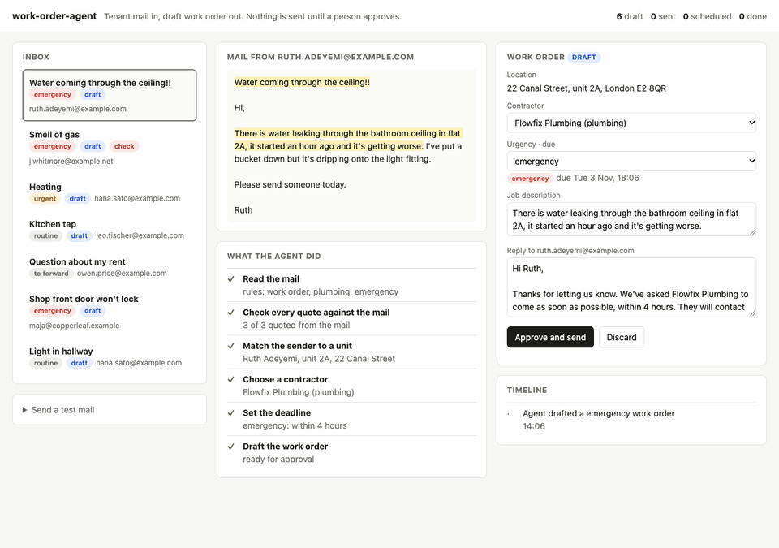

# work-order-agent

[](https://github.com/joelliewweiyi-del/work-order-agent/actions/workflows/test.yml)

An agent that turns tenant mail into work orders. It reads the mail, quotes the unit, issue and urgency, picks a contractor and drafts the order and the reply. A person approves before anything goes out.



A property manager's inbox mixes leaks, broken locks and rent questions. Each repair mail means finding the unit, judging how urgent it is, picking the right contractor and writing two messages. This agent does that work up to the draft, and shows every step it took. A person only reviews and approves.

## Flow

```
tenant mail ─▶ triage (rules or LLM) ─▶ quotes checked against the mail ─▶ sender matched to a unit
           ─▶ contractor by trade ─▶ deadline by urgency ─▶ draft ─▶ person approves ─▶ sent ─▶ scheduled ─▶ done
```

Non-repair mail, like a rent question, is routed to the property manager without a work order.

## What it won't do on its own

- **Use a value the mail doesn't contain.** Every unit, issue and urgency must quote the mail. The quote check comes from [doc-trace](https://github.com/joelliewweiyi-del/doc-trace), and it drops anything the model invents.
- **Trust a unit number over the sender.** The sender's address decides the unit. If the mail names a different unit, or the sender is unknown, the draft is flagged and the unit is left blank.
- **Send anything.** A draft without a unit can't be approved. Only a person moves a draft to sent.

## Run it

Needs Node.js 22 or later.

```sh
npm install
npm start          # http://localhost:3000
```

No API key needed. The agent processes seven made-up mails at startup:

| Mail | Result |
|---|---|
| Water through the ceiling, flat 2A | plumbing, emergency (water near a light), due in 4 hours |
| Smell of gas, from someone who isn't a tenant | heating, emergency, flagged: unknown sender, unit to be set by hand |
| Radiators cold, unit 12 | heating, urgent, due in 24 hours |
| Dripping tap, "not urgent" | plumbing, routine, due in 5 days |
| Question about the rent | not a repair, forward |
| Shop door won't lock | locks, emergency |
| Hallway light flickers | electrical, routine |

Use **Send a test mail** to try your own.

## Use an LLM

The offline rules are keyword-based. For real mail set a key, and the agent triages with a model (Grok by default):

```sh
XAI_API_KEY=... npm start
LLM_API_KEY=... LLM_BASE_URL=https://api.openai.com/v1 LLM_MODEL=gpt-4.1 npm start
```

The model has to return a quote for each value (see `src/llm.js`). The same checks apply to its output.

## Layout

```
src/rules.js   offline triage: trade, urgency, unit, each with its sentence
src/llm.js     LLM triage (OpenAI-compatible, Grok by default)
src/agent.js   the pipeline and its step log
src/store.js   statuses and what a person can do from each
data/          the made-up register (units, tenants, contractors) and inbox
```

## Tests

```sh
npm test
```

The tests cover triage of every sample mail, the urgency edge cases, a unit the model invents, a unit that disagrees with the sender, an unknown sender, and the status rules (no approval without a unit, a refused approval changes nothing).

## Design decisions

| Decision | Alternative I rejected | Why |
|---|---|---|
| The sender's address decides the unit | Trust the unit named in the mail | Tenants mention neighbours' flats, and models misread numbers. The tenant register is the source of truth, and the mail can only agree with it. |
| The agent drafts; a person sends | Send emergencies automatically | A wrong contractor at 2 a.m. costs more than a minute of review. The draft is ready, so approving takes seconds. |
| Every step is logged in plain words | A single "confidence" label | The property manager sees why a draft was flagged ("sender rents 5C, mail says 2A") and fixes exactly that. |
| Deadlines come from a fixed table per urgency | Let the model pick a deadline | Service levels are a contract with tenants. They belong in configuration, not in a prompt. |
| Non-repair mail is routed, not answered | Let the agent reply to everything | A rent question needs someone who knows the lease. Routing it is the useful action. |
| Status moves only along a fixed path | Free-form status updates | Draft → sent → scheduled → done. A job can't be marked done before it was sent, and a refused approval changes nothing. |

## Limits

- No real mail connection. Mail comes from `data/inbox.json` or the test form.
- State is in memory. Restarting resets the demo.
- Every person, company and address here is made up.

## What's next

- **A real mailbox.** IMAP or Microsoft Graph in, with the same pipeline.
- **Contractor replies.** Read the contractor's mail and move the job to scheduled or done, with the quote as evidence.
- **Photos.** Tenants send photos of leaks. A vision model describes them, quoted like any other field.
- **An evaluation set.** A few hundred realistic mails with expected trade, urgency and unit, and a confusion matrix per release.
- **More languages.** Dutch first: most tenant mail in the Netherlands isn't in English.

## License

MIT
